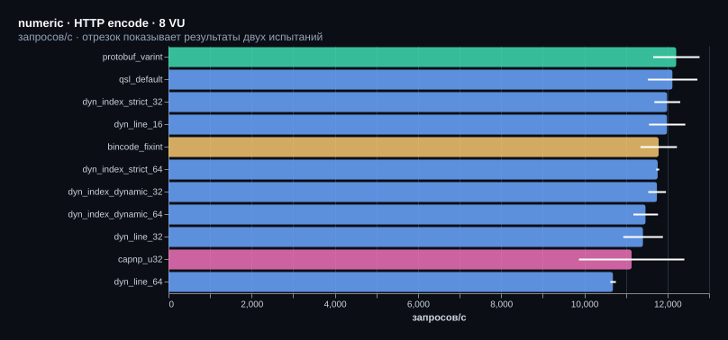
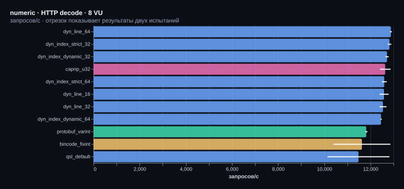
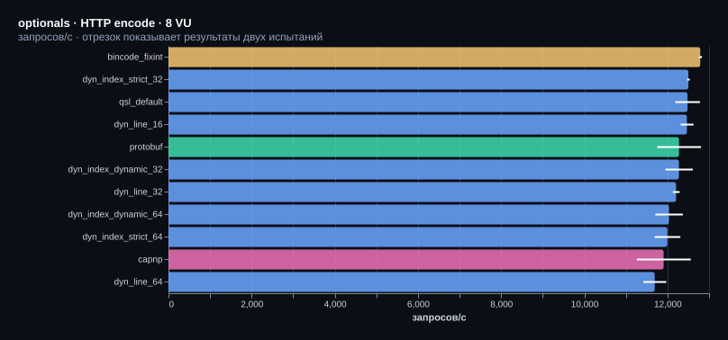
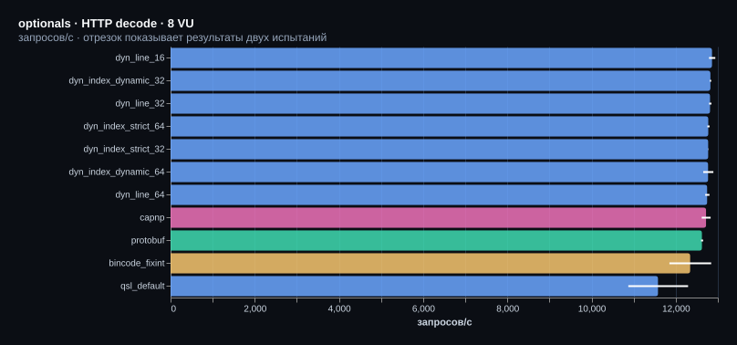
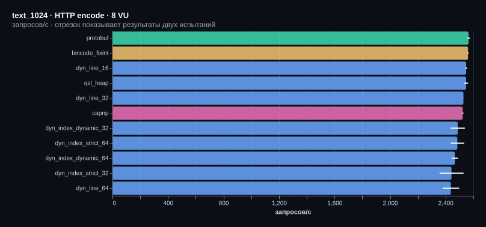
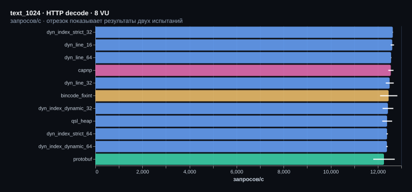

# k6: HTTP-нагрузка на одинаковых структурах и всех Dyn-режимах

**144 завершённых испытания без ошибок содержимого**: 33 профиля × запись/чтение × два противоположных порядка, два транспортных контроля × два порядка, восемь дополнительных испытаний с заданной частотой. k6 2.2.0, локальный Rust HTTP/1.1-сервер, keep-alive, без TLS. Ни один запрос не направлялся на production-сайт.

На испытание: 2 с прогрева, 1 с разделения фаз, 10 с измерения. Основной closed model: 8 VU, без think time. Сервер закреплён на логическом ядре 2, k6 — на 0/1/3. Оба процесса находятся на одном i5-7400; это измеряет весь демонстрационный HTTP-путь и работу генератора нагрузки, а не только кодек, не удалённую сеть и не Cap’n Proto RPC/gRPC.

**Фоновая нагрузка:** вне сервера и k6 она занимала от 0.23 до 1.14 логических ядер. Эти испытания не заявляются как замеры на полностью свободной машине. CPU клиента, сервера и остальных процессов записан для каждого испытания; ограничителем может быть генератор нагрузки.

## Контракт

`encode`: GET с индексом записи; сервер сериализует заранее подготовленный native-объект в повторно используемый буфер. k6 сравнивает **каждый** ответный байт с заранее проверенным кадром.

`decode`: POST настоящего бинарного кадра; сервер выполняет checked-декодирование и общий checksum всех полей/всех байтов текста, создаёт owned-результат и уничтожает его. k6 сравнивает 64-битный результат с эталоном. В каждом профиле циклически проходят все 256 записей. Временная память Dyn размещается на стеке и входит в чтение.

Транспортные контроли возвращают готовый кадр/готовый checksum без кодека; их время не вычитается. Данные, HTTP-парсер, потоки и обработчик одинаковы для протоколов. На клиенте проверка encode зависит от длины кадра; её стоимость влияет на достигнутый RPS.

RPS = число завершённых запросов измерительной фазы / заданное окно. Средние RPS и p95 ниже усредняют два отдельных испытания, а **не** объединяют выборки или квантили. Диапазоны показывают два результата. Исходные p50/p95/p99, ошибки, CPU и счётчики находятся в [CSV](results/k6/measurements.csv).

**Разрешение таймера:** на этой машине k6 зарегистрировал 0 мс в 120 медианах и 1 значениях p95. Задержки ниже разрешения измерения следует читать как «ниже разрешения». Эти значения сохранены в CSV. Время самого кодека измерено отдельно в Criterion.

## numeric

### encode: одинаковые структуры

| Кодек / режим | Кадр, B | RPS: среднее (диапазон) | p95, мс: среднее (диапазон) | Дрейф RPS, % |
|---|---:|---:|---:|---:|
| qsl_default | 16.00 | 12122.95 (11526.80–12719.10) | 2.10 (2.06–2.13) | 9.84 |
| protobuf_varint | 11.88 | 12213.65 (11656.60–12770.70) | 2.15 (2.00–2.30) | 9.12 |
| bincode_fixint | 16.00 | 11788.95 (11351.30–12226.60) | 2.17 (2.00–2.33) | 7.42 |
| capnp_u32 | 32.00 | 11137.95 (9871.10–12404.80) | 2.19 (2.05–2.32) | 22.75 |

### encode: все режимы Dyn

| Кодек / режим | Кадр, B | RPS: среднее (диапазон) | p95, мс: среднее (диапазон) | Дрейф RPS, % |
|---|---:|---:|---:|---:|
| dyn_line_16 | 44.00 | 11992.50 (11556.40–12428.60) | 2.05 (2.04–2.06) | 7.27 |
| dyn_line_32 | 60.00 | 11413.30 (10937.00–11889.60) | 2.01 (2.00–2.01) | 8.35 |
| dyn_line_64 | 92.00 | 10692.70 (10626.30–10759.10) | 2.01 (2.00–2.01) | 1.24 |
| dyn_index_dynamic_32 | 48.00 | 11750.20 (11537.30–11963.10) | 2.03 (2.01–2.05) | 3.62 |
| dyn_index_dynamic_64 | 64.00 | 11475.60 (11179.80–11771.40) | 2.00 (2.00–2.00) | 5.16 |
| dyn_index_strict_32 | 48.00 | 11995.35 (11683.70–12307.00) | 2.02 (2.01–2.02) | 5.20 |
| dyn_index_strict_64 | 64.00 | 11764.55 (11728.60–11800.50) | 2.00 (2.00–2.00) | 0.61 |

### decode: одинаковые структуры

| Кодек / режим | Кадр, B | RPS: среднее (диапазон) | p95, мс: среднее (диапазон) | Дрейф RPS, % |
|---|---:|---:|---:|---:|
| qsl_default | 16.00 | 11482.90 (10141.80–12824.00) | 2.38 (2.07–2.68) | 23.36 |
| protobuf_varint | 11.88 | 11823.25 (11775.60–11870.90) | 2.27 (2.01–2.53) | 0.81 |
| bincode_fixint | 16.00 | 11633.25 (10401.00–12865.50) | 2.44 (2.23–2.65) | 21.18 |
| capnp_u32 | 32.00 | 12644.90 (12416.20–12873.60) | 2.72 (2.61–2.82) | 3.62 |

### decode: все режимы Dyn

| Кодек / режим | Кадр, B | RPS: среднее (диапазон) | p95, мс: среднее (диапазон) | Дрейф RPS, % |
|---|---:|---:|---:|---:|
| dyn_line_16 | 44.00 | 12591.90 (12397.20–12786.60) | 2.78 (2.77–2.78) | 3.09 |
| dyn_line_32 | 60.00 | 12544.50 (12392.80–12696.20) | 2.66 (2.53–2.78) | 2.42 |
| dyn_line_64 | 92.00 | 12888.50 (12848.90–12928.10) | 2.89 (2.77–3.01) | 0.61 |
| dyn_index_dynamic_32 | 48.00 | 12720.15 (12648.10–12792.20) | 2.75 (2.70–2.79) | 1.13 |
| dyn_index_dynamic_64 | 64.00 | 12463.60 (12437.30–12489.90) | 2.71 (2.64–2.78) | 0.42 |
| dyn_index_strict_32 | 48.00 | 12828.15 (12751.40–12904.90) | 2.79 (2.77–2.81) | 1.20 |
| dyn_index_strict_64 | 64.00 | 12603.60 (12498.80–12708.40) | 2.81 (2.78–2.83) | 1.66 |

## optionals

### encode: одинаковые структуры

| Кодек / режим | Кадр, B | RPS: среднее (диапазон) | p95, мс: среднее (диапазон) | Дрейф RPS, % |
|---|---:|---:|---:|---:|
| qsl_default | 8.50 | 12484.70 (12189.00–12780.40) | 2.52 (2.48–2.55) | 4.74 |
| protobuf | 10.47 | 12280.40 (11755.10–12805.70) | 2.43 (2.10–2.77) | 8.56 |
| bincode_fixint | 10.50 | 12793.35 (12757.60–12829.10) | 2.52 (2.51–2.54) | 0.56 |
| capnp | 32.00 | 11910.85 (11261.20–12560.50) | 2.34 (2.32–2.36) | 10.91 |

### encode: все режимы Dyn

| Кодек / режим | Кадр, B | RPS: среднее (диапазон) | p95, мс: среднее (диапазон) | Дрейф RPS, % |
|---|---:|---:|---:|---:|
| dyn_line_16 | 29.50 | 12471.80 (12317.10–12626.50) | 2.26 (2.15–2.36) | 2.48 |
| dyn_line_32 | 39.50 | 12211.35 (12129.40–12293.30) | 2.04 (2.01–2.06) | 1.34 |
| dyn_line_64 | 59.50 | 11695.50 (11420.10–11970.90) | 2.00 (2.00–2.00) | 4.71 |
| dyn_index_dynamic_32 | 33.50 | 12279.40 (11951.20–12607.60) | 2.18 (2.02–2.34) | 5.35 |
| dyn_index_dynamic_64 | 43.50 | 12039.90 (11709.20–12370.60) | 2.03 (2.02–2.04) | 5.49 |
| dyn_index_strict_32 | 33.50 | 12504.70 (12473.70–12535.70) | 2.07 (2.03–2.12) | 0.50 |
| dyn_index_strict_64 | 43.50 | 11999.70 (11689.50–12309.90) | 2.03 (2.02–2.03) | 5.17 |

### decode: одинаковые структуры

| Кодек / режим | Кадр, B | RPS: среднее (диапазон) | p95, мс: среднее (диапазон) | Дрейф RPS, % |
|---|---:|---:|---:|---:|
| qsl_default | 8.50 | 11583.00 (10873.10–12292.90) | 2.71 (2.65–2.77) | 12.26 |
| protobuf | 10.47 | 12625.80 (12600.70–12650.90) | 2.69 (2.60–2.78) | 0.40 |
| bincode_fixint | 10.50 | 12345.70 (11849.70–12841.70) | 2.78 (2.78–2.79) | 8.04 |
| capnp | 32.00 | 12722.80 (12616.90–12828.70) | 2.74 (2.71–2.77) | 1.66 |

### decode: все режимы Dyn

| Кодек / режим | Кадр, B | RPS: среднее (диапазон) | p95, мс: среднее (диапазон) | Дрейф RPS, % |
|---|---:|---:|---:|---:|
| dyn_line_16 | 29.50 | 12864.90 (12790.20–12939.60) | 2.72 (2.65–2.78) | 1.16 |
| dyn_line_32 | 39.50 | 12819.50 (12790.80–12848.20) | 2.73 (2.68–2.78) | 0.45 |
| dyn_line_64 | 59.50 | 12750.45 (12700.00–12800.90) | 2.74 (2.70–2.79) | 0.79 |
| dyn_index_dynamic_32 | 33.50 | 12824.85 (12807.30–12842.40) | 2.78 (2.78–2.78) | 0.27 |
| dyn_index_dynamic_64 | 43.50 | 12773.10 (12652.70–12893.50) | 2.78 (2.77–2.79) | 1.89 |
| dyn_index_strict_32 | 33.50 | 12775.25 (12771.10–12779.40) | 2.72 (2.66–2.78) | 0.06 |
| dyn_index_strict_64 | 43.50 | 12777.15 (12750.60–12803.70) | 2.77 (2.76–2.78) | 0.42 |

## text_1024

### encode: одинаковые структуры

| Кодек / режим | Кадр, B | RPS: среднее (диапазон) | p95, мс: среднее (диапазон) | Дрейф RPS, % |
|---|---:|---:|---:|---:|
| qsl_heap | 1032.00 | 2547.95 (2533.90–2562.00) | 5.77 (5.76–5.79) | 1.10 |
| protobuf | 1032.93 | 2565.60 (2556.60–2574.60) | 5.77 (5.72–5.82) | 0.70 |
| bincode_fixint | 1036.00 | 2562.60 (2558.80–2566.40) | 5.71 (5.69–5.73) | 0.30 |
| capnp | 1064.00 | 2524.10 (2519.70–2528.50) | 5.78 (5.77–5.79) | 0.35 |

### encode: все режимы Dyn

| Кодек / режим | Кадр, B | RPS: среднее (диапазон) | p95, мс: среднее (диапазон) | Дрейф RPS, % |
|---|---:|---:|---:|---:|
| dyn_line_16 | 1052.00 | 2548.60 (2542.00–2555.20) | 5.74 (5.73–5.74) | 0.52 |
| dyn_line_32 | 1060.00 | 2529.30 (2528.70–2529.90) | 5.75 (5.68–5.81) | 0.05 |
| dyn_line_64 | 1076.00 | 2438.55 (2378.90–2498.20) | 5.95 (5.82–6.08) | 4.89 |
| dyn_index_dynamic_32 | 1056.00 | 2487.80 (2436.60–2539.00) | 5.83 (5.65–6.01) | 4.12 |
| dyn_index_dynamic_64 | 1064.00 | 2466.75 (2443.40–2490.10) | 5.95 (5.88–6.02) | 1.89 |
| dyn_index_strict_32 | 1056.00 | 2443.00 (2356.50–2529.50) | 6.01 (5.90–6.12) | 7.08 |
| dyn_index_strict_64 | 1064.00 | 2485.60 (2437.90–2533.30) | 5.87 (5.74–6.01) | 3.84 |

### decode: одинаковые структуры

| Кодек / режим | Кадр, B | RPS: среднее (диапазон) | p95, мс: среднее (диапазон) | Дрейф RPS, % |
|---|---:|---:|---:|---:|
| qsl_heap | 1032.00 | 12401.20 (12191.30–12611.10) | 2.77 (2.76–2.78) | 3.39 |
| protobuf | 1032.93 | 12265.40 (11808.80–12722.00) | 2.66 (2.52–2.79) | 7.45 |
| bincode_fixint | 1036.00 | 12465.85 (12098.10–12833.60) | 2.78 (2.78–2.79) | 5.90 |
| capnp | 1064.00 | 12559.35 (12449.60–12669.10) | 2.79 (2.78–2.80) | 1.75 |

### decode: все режимы Dyn

| Кодек / режим | Кадр, B | RPS: среднее (диапазон) | p95, мс: среднее (диапазон) | Дрейф RPS, % |
|---|---:|---:|---:|---:|
| dyn_line_16 | 1052.00 | 12621.15 (12551.00–12691.30) | 2.72 (2.65–2.78) | 1.11 |
| dyn_line_32 | 1060.00 | 12510.75 (12341.60–12679.90) | 2.82 (2.78–2.87) | 2.70 |
| dyn_line_64 | 1076.00 | 12571.40 (12563.10–12579.70) | 2.85 (2.79–2.91) | 0.13 |
| dyn_index_dynamic_32 | 1056.00 | 12434.00 (12206.00–12662.00) | 2.81 (2.80–2.81) | 3.67 |
| dyn_index_dynamic_64 | 1064.00 | 12391.95 (12360.80–12423.10) | 2.83 (2.73–2.94) | 0.50 |
| dyn_index_strict_32 | 1056.00 | 12643.95 (12636.90–12651.00) | 2.87 (2.79–2.95) | 0.11 |
| dyn_index_strict_64 | 1064.00 | 12399.65 (12369.90–12429.40) | 2.81 (2.80–2.82) | 0.48 |

## Контроли транспорта без кодека

| Кодек / режим | Кадр, B | RPS: среднее (диапазон) | p95, мс: среднее (диапазон) | Дрейф RPS, % |
|---|---:|---:|---:|---:|
| control_encode | 1032.00 | 2504.70 (2426.20–2583.20) | 5.84 (5.67–6.01) | 6.27 |
| control_decode | 1032.00 | 12729.85 (12574.00–12885.70) | 2.66 (2.61–2.72) | 2.45 |

## Open model: 1000 запросов/с

Отдельные constant-arrival-rate испытания для чтения numeric и text_1024; 32 заранее выделенных VU, 10 с измерения. dropped_iterations означает, что запланированная итерация не была начата, а не ошибку декодирования. Эти испытания проверяют достижение заданной частоты; они не устанавливают максимальную пропускную способность.

| Структура | Кодек | Достигнутые запросы/с | p95, мс | Dropped |
|---|---|---:|---:|---:|
| numeric | qsl_default | 1000.00 | 0.51 | 0 |
| numeric | protobuf_varint | 1000.00 | 0.32 | 0 |
| numeric | bincode_fixint | 1000.00 | 0.33 | 0 |
| numeric | capnp_u32 | 997.40 | 0.46 | 27 |
| text_1024 | qsl_heap | 1000.10 | 0.43 | 0 |
| text_1024 | protobuf | 1000.10 | 0.51 | 0 |
| text_1024 | bincode_fixint | 1000.10 | 0.34 | 0 |
| text_1024 | capnp | 1000.10 | 0.00 | 0 |

Без пропусков прошли 7 из 8 испытаний. Всего пропущено 27 запланированных итераций.

Всего проверенных запросов измерительных фаз: 14444090. HTTP-ошибок и ошибок содержимого: 0. Разброс между прогонами и близость к транспортным контролям ограничивают выводы о небольших различиях кодеков. Для изолированного времени используйте [одинаковые структуры](SAME-STRUCTURES.md), [QSL](QSL-ONLY.md) и [Dyn](DYN.md).

[JSON](results/k6/summary.json) · [полные k6 summary](results/k6/trials) · [сервер](http/src/main.rs) · [скрипт нагрузки](k6/load.js) · [документация k6](https://grafana.com/docs/k6/latest/using-k6/scenarios/executors/constant-arrival-rate/).
