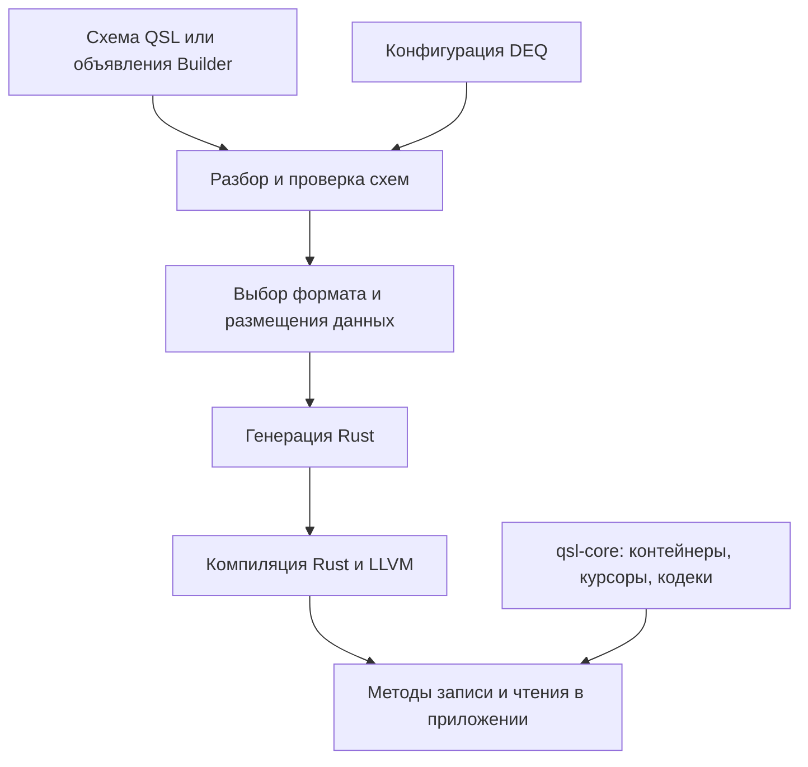
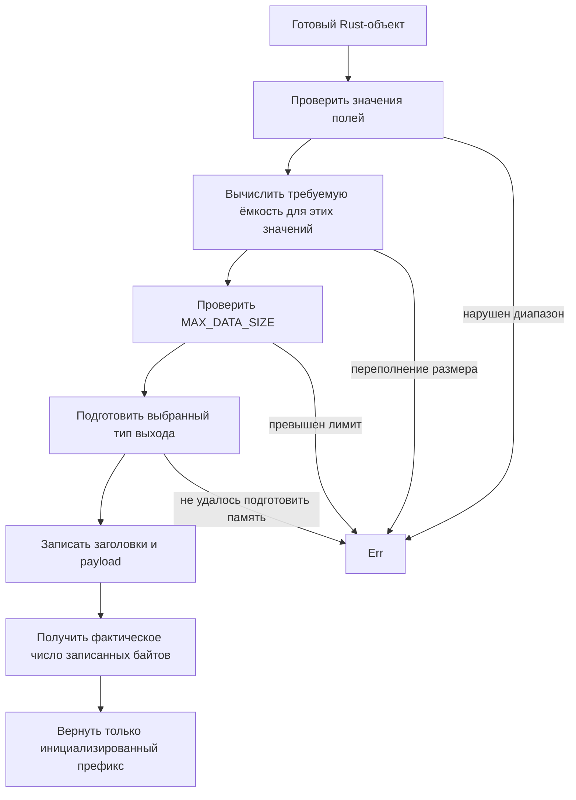
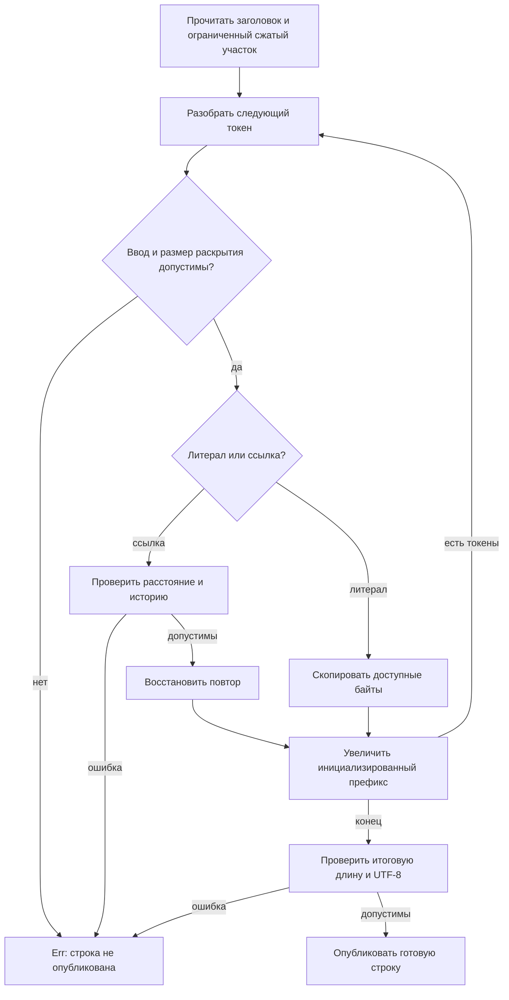
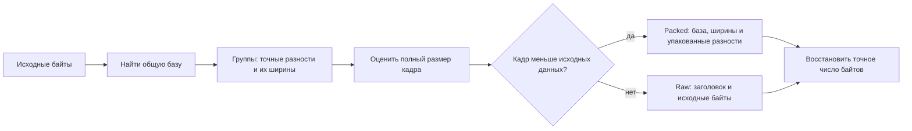
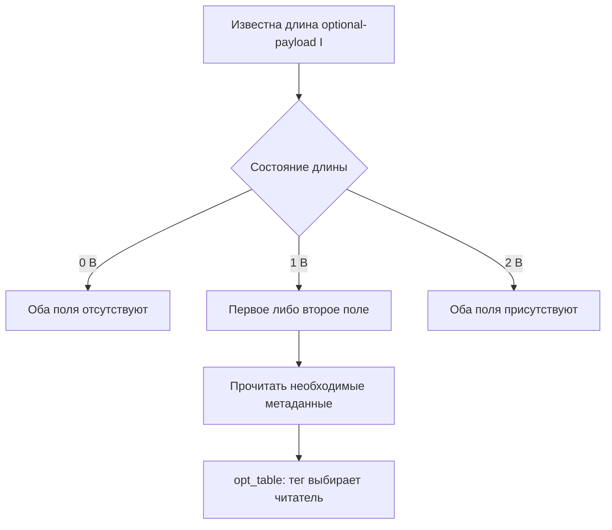
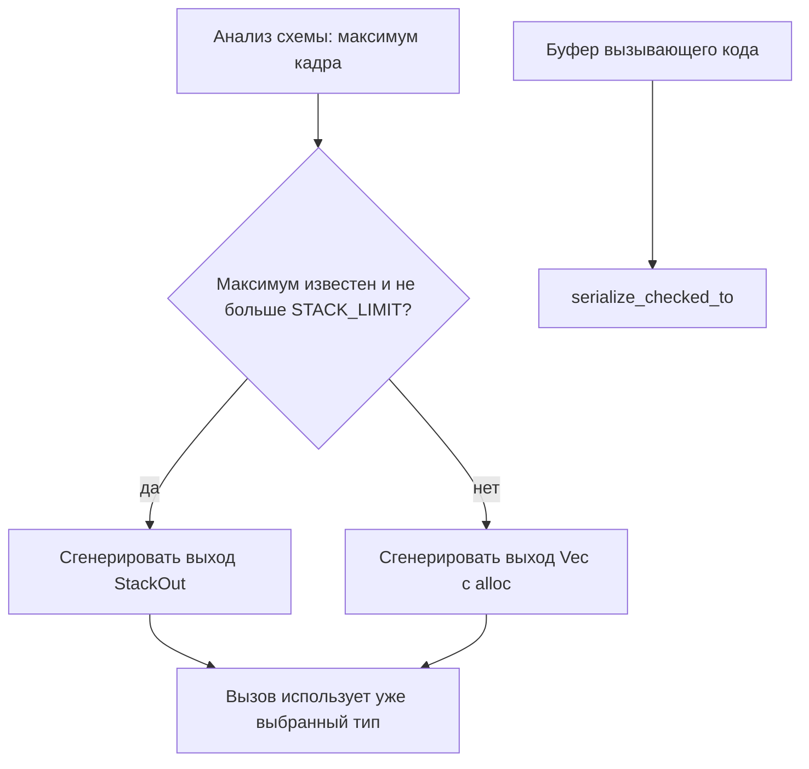
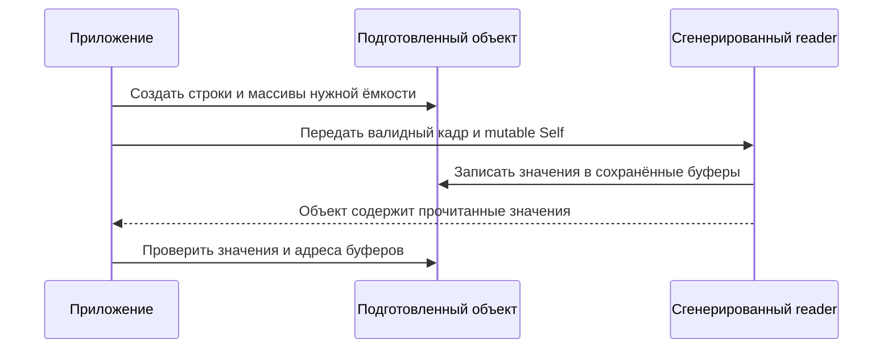
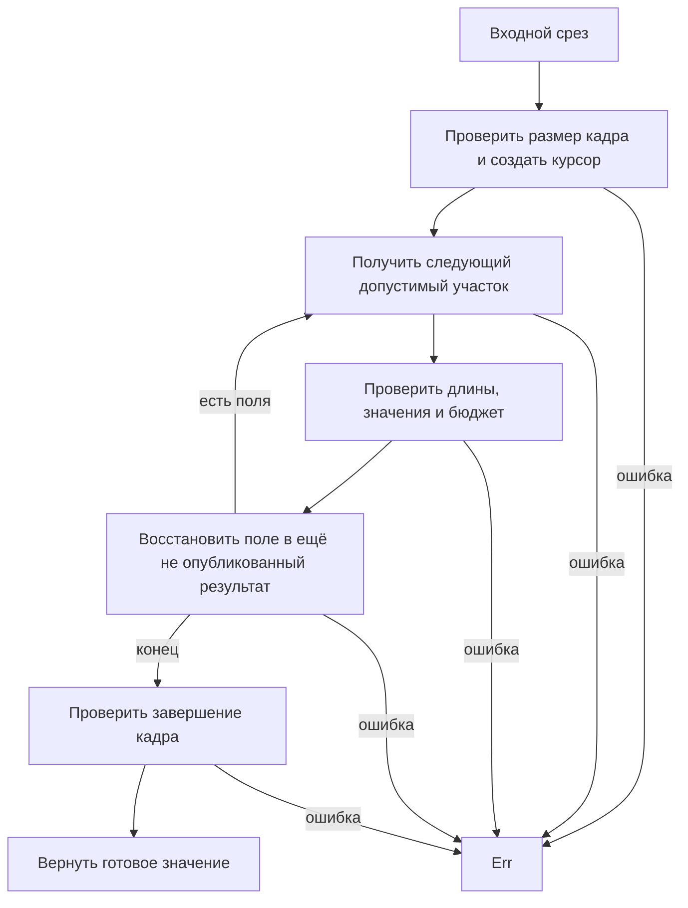

# QSL — как устроен обмен данными

**QSL (Quick Schema Language)** — язык описания данных и инструментарий генерации специализированных бинарных кодеков для Rust.

Исходная задача QSL — обмен заранее описанными данными между сторонами, которые контролируют их структуру, допустимые значения и способ размещения в памяти. Схема задаёт условия, на которые может опираться сгенерированный код: диапазоны чисел, длины строк и массивов, обязательность полей и выбранный формат записи.

QSL ориентирован на внутренние протоколы, телеметрию и повторяющиеся записи с известными ограничениями. Его специализация требует подробного описания данных и согласованности схем на обеих сторонах обмена.

## Содержание

- [Анализ и генерация кода](#от-схемы-к-выполняемому-коду)
- [Схема](#что-задаёт-схема) и [Builder](#создание-через-builder)
- [Числа и обратимость](#числа-и-битовая-упаковка)
- [Строки, LZ и QPS](#строки-массивы-и-сжатие)
- [Опциональные поля](#опциональные-поля-три-разные-задачи)
- [Память, reuse и no_std](#память-и-выходной-кадр)
- [Безопасное чтение](#проверяемый-и-непроверяемый-доступ)
- [Раскладка и BMI2](#раскладка-и-процессор)
- [Проверки и доказательства](#проверяемые-утверждения-и-границы-доказательств)

## От схемы к выполняемому коду

Основной анализ происходит при сборке приложения. QSL разбирает описание, проверяет ограничения и генерирует Rust-типы вместе с методами записи и чтения. Rust-компилятор превращает этот исходный код в машинный.



Во время обмена приложение вызывает уже скомпилированные методы. Разбор текста схемы для каждой записи не требуется. Кадром здесь называется законченная бинарная запись; слово wire обозначает её передаваемое представление, в отличие от расположения полей в памяти.

| Компонент | Назначение |
|---|---|
| `qsl-lexer` | Разбор QSL и DEQ, сбор описаний и проверка схем. |
| `qsl-interpreter` | Подготовка раскладки и генерация исходного Rust. |
| `qsl-core` | Выполнение: чтение и запись, контейнеры, кодеки и проверки. |
| `qsl-rt` | Пулы заранее подготовленных буферов. |
| `qsl` | Прикладной интерфейс к компонентам проекта. |

Генератор Rust является этапом сборки, а не интерпретатором сообщений во время работы приложения. Схемы собираются в общий `QslSchemaBuilder`; выбранный backend использует это описание для генерации. Компиляцию полученного Rust через LLVM выполняет Rust-компилятор. Самостоятельный backend QSL → LLVM в этот путь не входит.

## Что задаёт схема

```qsl
&Packet[aggressive,safety] {
    u32(0..1000000) id|default=0|;
    str(1..32) name;
    u8?(0..15) status|default=0|;
}
```

`Packet` содержит обязательные `id` и `name`, затем опциональное поле `status`. Обязательные поля должны располагаться перед опциональными. Остальные механики включаются атрибутами и конфигурацией.

Диапазоны QSL включают обе границы. Поле `name` допускает от 1 до 32 байтов UTF-8. Это ограничение байтов, а не количества отображаемых символов: текст `Яa` занимает 3 байта. Для массивов длина задаётся в элементах.

`default` описывает значение инициализации и не превращает отсутствующее опциональное поле в присутствующее. Отсутствие `status` сохраняется как отдельное состояние.

В примере `safety` включает проверяемое чтение, а `aggressive` разрешает предусмотренные генератором изменения физического представления. Формат передаваемых байтов и раскладка Rust-объекта рассматриваются раздельно.

## Создание через Builder

Схему можно задать программно в `build.rs`. Типизированные объявления и QSL-текст проходят общий анализ. `QslBuilder` собирает схемы; в `config` передаётся `DeqBuilder`, в `schem` — `QslSchemaBuilder`.

```rust
use qsl::{InterpreterBuilderExt, QslBuilder};

fn main() -> Result<(), Box<dyn std::error::Error>> {
    let schemas = QslBuilder::new()
        .config(|c| {
            c.stack_limit(64).max_data_size(65535);
        })
        .schem(|s| {
            s.name("Packet").safety().aggresive(false, false);
            s.field("id").u32(0, 1_000_000, 0, false);
            s.field("name").str(1, 32, false, false);
            s.field("status").u8(0, 15, 0, true);
        })
        .build()?;

    let out = std::path::PathBuf::from(std::env::var("OUT_DIR")?);
    std::fs::write(out.join("qsl_gen.rs"), schemas.use_interpreter()?)?;
    Ok(())
}
```

Для чисел аргументы задают минимум, максимум, значение инициализации и опциональность. Для `str` — минимальную длину, максимальную длину, применение строкового кодека и опциональность. Метод `aggresive(false, false)` разрешает агрессивное размещение без сдвига длины и без дополнительной маски присутствия в памяти.

Приложение подключает сгенерированный файл и использует конкретный Rust-тип:

```rust
include!(concat!(env!("OUT_DIR"), "/qsl_gen.rs"));

fn main() -> qsl::QslResult<()> {
    let packet = Packet::try_new(
        42,
        qsl::StackString::try_from_str("QSL")?,
        Some(7),
    )?;
    let frame: qsl::StackOut<42> = packet.serialize_checked()?;
    let restored = Packet::deserialize_checked(&frame)?;
    assert_eq!(restored.name.as_str(), "QSL");
    assert_eq!(restored.status(), Some(7));
    Ok(())
}
```

Конструкторы и методы зависят от схемы. Здесь `try_new` относится к представлению с опциональным полем; наличие такого конструктора не предполагается для каждого сгенерированного типа. Для данного `Packet` строка имеет тип `StackString<32>`, а максимум кадра — 42 B. Фактическая запись с именем `QSL` занимает 12 B без `status` и 13 B с ним.

Зависимость `qsl` нужна как приложению, так и его `build.rs`. [Запускаемый пример](../examples/08-builders/README.md) показывает объявление через Builder и через текст с проверкой одинаковых байтов и хэшей. [Сборка схем из файлов](../examples/compiler-pipeline/build.rs) использует тот же общий сборщик.

### Разбор кадра по байтам

Для показанного `Packet` проверены обе записи с `id=42` и именем `QSL`:

```text
status=None:    00 2a 00 00 00 03 00 00 00 51 53 4c
status=Some(7): 01 2a 00 00 00 03 00 00 00 51 53 4c 07
```

| Смещение в байтах | Содержимое | Размер |
|---|---|---|
| 0 | Метаданные присутствия единственного optional-поля | 1 B |
| 1–4 | `id`, little-endian | 4 B |
| 5–8 | Длина имени в байтах UTF-8 | 4 B |
| 9–11 | Байты `QSL` | 3 B |
| 12, если поле присутствует | `status` | 1 B |

Эта схема не включает `compact`: диапазон `id` проверяется, но число занимает 4 B. Размер её кадра определяется длиной имени и присутствием `status`:

$$
F(n,p)=1+4+4+n+p=9+n+p,\qquad 1\le n\le32,\quad p\in\{0,1\}.
$$

Отсюда следуют фактические размеры 12 и 13 B, а максимум равен 42 B. Это объясняет тип `StackOut<42>` при лимите 64 B; он не означает, что каждая запись передаёт все 42 B. Данные воспроизводятся в [примере Builder](../examples/08-builders/main.rs).

### Последовательность записи

Следующая схема относится к обычному `serialize_checked`. Конкретный тип выходного буфера уже выбран генератором.



При `serialize_checked_to` память передаёт приложение; дополнительно проверяется её вместимость. Для LZ требуемая ёмкость и фактическая длина результата могут различаться. В транспорт передаётся записанный префикс, а не вся ёмкость буфера.

## Числа и битовая упаковка

Обычная запись сохраняет число в выбранном формате. Атрибут `compact` позволяет использовать ширину, необходимую для объявленного диапазона. Для непрерывного целочисленного диапазона от нижней границы до верхней количество допустимых значений, ширина и ранг имеют вид:

$$
N=b-a+1,\qquad w=\lceil\log_2 N\rceil,\qquad r=x-a.
$$

Здесь нижняя граница обозначена через $a$, верхняя — через $b$, исходное значение — через $x$. При чтении значение восстанавливается из ранга:

$$
x=a+r.
$$

Расчёт ширины выполняется при анализе целочисленно. Логарифм в формуле объясняет правило и не означает вызов операции с плавающей точкой во время записи.

Например, диапазону `0..4095` достаточно 12 бит. Четыре таких поля `u32` занимают 16 B в памяти и 6 B в compact-кадре без дополнительных полей. Восстановление сохраняет исходные значения точно. Проверяемое чтение также отклоняет коды вне допустимого диапазона.

### Почему восстановление означает отсутствие коллизий кодека

Обозначим допустимые значения схемы через $V_S$, кодирование через $E_S$, декодирование через $D_S$. Требуемое свойство имеет вид:

$$
\forall x\in V_S:\quad D_S(E_S(x))=x.
$$

Если два допустимых значения имеют одинаковую запись, применение декодера к обеим сторонам даёт:

$$
E_S(x)=E_S(y)\;\Longrightarrow\;D_S(E_S(x))=D_S(E_S(y))\;\Longrightarrow\;x=y.
$$

Следовательно, точное восстановление обеспечивает инъективность кодирования внутри согласованной схемы. Это не утверждение об отсутствии коллизий хэша схемы и не возможность декодировать запись без знания формата.

Переход от свойства восстановления к инъективности проверен леммой `roundtrip_implies_injective` в [Overview.lean](../proofs/Overview.lean). Она доказывает математическое следствие при указанном условии. Выполнение самого условия Rust-кодеком проверяется исполняемыми тестами.

## Строки, массивы и сжатие

Представление строки зависит от ограничений, владения и бюджета памяти.

| Представление | Как используются данные |
|---|---|
| `String` | Собственная строка в heap через `alloc`. |
| `&str` | Заимствованный UTF-8; время жизни связано с входным буфером. |
| `StackString<N>` | Ограниченная строка со встроенной ёмкостью и raw UTF-8 в кадре. |
| `InlineString<N>` | Ограниченный UTF-8 и строковый кодек QSL-LZ при записи. |
| `[u8; N]` | Фиксированная строка при допустимом нативном размере. |

Маленький `InlineString` размещается непосредственно в структуре. Если его нативный размер превышает бюджет, генератор выбирает heap-представление `Box<InlineString<N>>`. Оно создаётся через `try_boxed_from_str` сразу в heap, без промежуточного большого контейнера на стеке. Выбор определяется ёмкостью схемы при генерации, а не длиной отдельного значения.

Для массивов используются фиксированные массивы, ограниченный `InlineArray` или `Vec`. На выбор влияют тип элемента, максимальная длина и разрешённые оптимизации. Одна известная длина массива ещё не гарантирует возможность заимствовать его как Rust-срез: должны совпадать формат элементов, выравнивание и условия доступа к памяти.

QSL-LZ включается для строки атрибутом `decompress=true`. В памяти строка хранится как UTF-8; при записи кодек использует литералы и ссылки на уже записанные последовательности. Когда упаковка невыгодна, выбирается raw-представление. Заголовок учитывается отдельно: обещания уменьшить любые входные данные нет.

QPS — отдельный механизм обратимого кодирования на основе операндов и квантования. Квант по умолчанию — Q16; доступны Q2, Q4, Q8 и Q16. Для восстановления сохраняются необходимые части исходного значения. QPS не определяет присутствие опциональных полей. Выбор scalar-пути или отдельного кодека всего payload зависит от схемы и вызываемого API; они не являются одним и тем же форматом.

[Пример строк](../examples/02-strings/README.md) показывает владение, заимствование, стек, heap и reuse. [Пример QPS](../examples/04-qps/main.rs) показывает числовую упаковку вместе со строкой.

### QSL-LZ: восстановление ограниченного префикса

Проверка сжатой строки опирается на фактически восстановленный объём. Для каждого токена известны ёмкость назначения $C$, число уже записанных байтов $p$ и длина следующего раскрытия $n$:

$$
0\le p\le C,\qquad n\le C-p\;\Longrightarrow\;p+n\le C.
$$

Для ссылки назад дополнительно требуется допустимое расстояние $d$:

$$
1\le d\le p.
$$

При копировании очередного байта с номером $k$ источник уже принадлежит инициализированному префиксу:

$$
p+k-d<p+k.
$$

Это допускает перекрывающиеся повторы: каждый скопированный байт может стать источником следующего. Проверка доступности сжатого ввода, арифметика размеров и проверка UTF-8 выполняются отдельно.



Индукция по токенам проста: до первого токена префикс пуст; каждый принятый токен сохраняет границу назначения; следовательно, она сохраняется после всей последовательности. В [Overview.lean](../proofs/Overview.lean) проверены `lz_token_bound` и `lz_match_source`. Леммы фиксируют арифметическую часть границ восстановления.

Конкретный кадр `84 00 41 df 01` восстанавливает ровно 100 байтов `A`. Заголовок задаёт сжатый участок из 4 B; литерал создаёт первый байт, ссылка с расстоянием 1 добавляет 99. Замена `df` на `ff` потребовала бы 132 B суммарного вывода и отклоняется для ёмкости 100 B, хотя заголовок остался прежним.

[Тест границ раскрытия](../qsl-core/src/validation.rs) проверяет этот случай. [Проверки сгенерированных схем](../proofs/qsl/tests/modernization/lib.rs) дополнительно охватывают inline/heap, фиксированные строки, усечённый ввод и суммарный бюджет нескольких полей. Если ошибочен первый токен heap-строки, проверено отклонение без выделения её `Box`.

### QPS: какие данные делают кодирование обратимым

Общий принцип сохранения числовых операндов можно записать через частное и остаток для положительного основания $q$:

$$
x=q\left\lfloor\frac{x}{q}\right\rfloor+(x\bmod q).
$$

Отбрасывание остатка меняет значение. Сохранение обеих частей позволяет восстановить исходное число; это проверено в [QPS.lean](../proofs/QPS.lean), леммы `payload_restore` и `payload_operands_injective`. Формула объясняет обратимость модели и не означает, что каждый runtime-кодек выполняет деление на каждой записи.

У байтового кодека QPB3 конкретная схема другая: выбранный квант задаёт число байтов в группе. Для всего входа сохраняется общая минимальная база $\beta$, а для каждого байта — точная разность:

$$
\beta=\min_i x_i,\qquad r_i=x_i-\beta,\qquad x_i=\beta+r_i.
$$

Для группы выбирается ширина $B_g$, достаточная для всех её разностей. Они упаковываются без перекрытия:

$$
R_g=\sum_{j=0}^{n_g-1}r_j\,2^{jB_g}.
$$

При нулевой ширине все байты группы равны базе. Для положительной ширины разности извлекаются сдвигом и маской. Вычитание повторённой базы из машинного слова допустимо потому, что ни один байтовый разряд не требует займа у соседнего: база не больше каждого исходного байта. Модель двух разрядов проверена в `two_lane_base_subtraction`; соответствие переносимых и CPU-ядер проверяется тестами.



Стоимость Packed включает 16 B оболочки QPB3 и один байт ширины на группу:

$$
M_{\mathrm{packed}}=16+\sum_g\left(1+\left\lceil\frac{n_gB_g}{8}\right\rceil\right).
$$

В воспроизведённом примере 256 одинаковых байтов при Q16 дают 16 групп нулевой ширины и кадр 32 B. Для последовательности из 16 байтов от 0 до 15 выбирается Raw; его кадр занимает 32 B, включая оболочку. Условие уменьшения относится к выбранному Packed, а raw-оболочка явно учитывается в размере. [Реализация и проверки](../qsl-core/src/qps_bytes.rs) также охватывают хвосты, все четыре кванта, значения байтов и повреждённые кадры.

## Опциональные поля: три разные задачи

| Механизм | Что он делает |
|---|---|
| `predict_seq` | Использует длину payload для вычисления числового состояния и допустимого состава полей. |
| `opt_table` | По тегу выбирает функцию чтения из подготовленной таблицы. |
| `optionals=bitmap` | Хранит присутствие опциональных полей в битовой маске кадра. |

`predict_seq` может обходиться без части метаданных только там, где состав полей однозначно следует из схемы и длины. Если разные наборы дают одну длину, одной длины недостаточно. `opt_table` решает задачу выбора обработчика по тегу; оба механизма могут применяться совместно.

Маска присутствия в Rust-объекте имеет другую роль. Оптимизированное хранение может использовать `MaybeUninit<T>` и отдельные биты активности. Неинициализированные отсутствующие поля не читаются и не уничтожаются как готовые значения. Для подходящих числовых диапазонов возможно использование `Option<NonZero<T>>`; допустимость такого представления следует из диапазона, а не из предположения о данных.

### Граф событий по длине

Рассмотрим только полезный хвост двух опциональных полей `u8`. Обозначим длину этого payload через $I$; метаданные присутствия в этот размер не включаются.



Числовой индекс критических событий в этой модели имеет вид:

$$
e(I)=\mathbf{1}_{I>0}+\mathbf{1}_{I>1}.
$$

Он различает три события, но не определяет имя единственного поля при длине 1 B. Два набора присутствия имеют одну сумму:

$$
(1,0)\ne(0,1),\qquad 1+0=0+1.
$$

В [Overview.lean](../proofs/Overview.lean) проверены однозначность пустого и полного хвоста и неоднозначность промежуточного. Это модель полезной длины, а не обещание, что весь кадр состоит только из этих байтов: фактические метаданные определяются форматом.

[Проверки optional-механик](../proofs/qsl/tests/optional-modes/lib.rs) сравнивают байты default/табличного чтения, перебирают состояния и проверяют недопустимые теги. Из математической модели не следует, что `opt_table` быстрее линейного выбора для любой схемы.

## Память и выходной кадр

`qsl-core` работает в `no_std`. Поддержка `alloc` разрешает `String`, `Vec` и `Box`, не вводя зависимость от `std`. Сам QSL не объявляет глобальный аллокатор: если приложение использует эти контейнеры с выделением памяти, соответствующую инфраструктуру предоставляет приложение. Без `alloc` доступны подходящие стековые и заимствованные представления, а также запись в переданные буферы.

У конфигурации два независимых ограничения:

- `STACK_LIMIT` задаёт бюджет встроенных строк и массивов, а также порог выбора стекового выходного кадра.
- `MAX_DATA_SIZE` ограничивает входной кадр, восстановленные данные и учитываемый объём динамического хранения; значение по умолчанию — 65535 B.

Для встроенных контейнеров учитываются служебная длина и выравнивание. Для выходного кадра сравнивается доказанный максимум передаваемых байтов, включая wire-заголовки. Если максимум кадра не превышает `STACK_LIMIT`, включая равенство, обычный выход — `StackOut<N>`; при большем или неизвестном максимуме используется `Vec<u8>`. Служебные поля самого `StackOut` не входят в число передаваемых байтов.

При `STACK_LIMIT=64` кадр с максимумом 64 B допускает стек, с максимумом 65 B — heap. Это правило не ограничивает размер всего Rust-объекта, стек функции или память процесса. У QPS есть отдельные типизированные выходы; включённый QSL_RT использует буферы своего пула.

`serialize_checked_to` записывает в память вызывающего кода. Для подходящих схем `deserialize_into` может обновлять уже подготовленные строки и массивы, сохраняя выделенные буферы. Такой reuse требует достаточной ёмкости и правильного контракта назначения; его нельзя автоматически обещать всем схемам и пользовательским кодекам.

`qsl-rt` предоставляет однопоточные `LocalRegions` и межпоточные `StaticRegions`. Полученный буфер удерживается владельцем занятого слота — объектом lease — до его уничтожения. Если все слоты заняты, возвращается `PoolExhausted`. Эти пулы работают внутри процесса и сами по себе не являются IPC.

### Где выбирается стек или heap



Ромб находится на этапе анализа. Он не означает проверку длины с переключением типа контейнера на каждом вызове. Маленькое текущее значение большой схемы не меняет выбранный выход.

В [проверке границы](../proofs/qsl/tests/modernization/lib.rs) схема с максимумом 64 B при лимите 64 B возвращает `StackOut<64>` с нулём выделений. Схема с максимумом 65 B возвращает `Vec<u8>` с одним выделением. Типы проверяются компилятором, число выделений — тестовым счётчиком. Размер самого `StackOut<64>` на проверенном стенде равен 68 B: 64 B кадра и служебная длина существуют в разных учётах.

У нативного `InlineString<N, u32>` на этом x86-64 стенде размер включает слово длины и округление к выравниванию:

$$
C_{\mathrm{native}}=4\left\lceil\frac{4+N}{4}\right\rceil.
$$

Поэтому ёмкость 252 B даёт объект 256 B, а ёмкость 253 B — объект 260 B. Эти случаи проверяет [анализ размещения](../qsl-lexer/src/layout.rs). Их нельзя подменять правилом выбора выходного кадра, где сравниваются передаваемые байты.

### Что подтверждает reuse



Схема показывает unchecked reuse: корректность кадра и ёмкости обеспечиваются до вызова. В тесте `prepared_required_heap_buffers_perform_no_allocation` подготовлены `String`, числовой `Vec` и отдельная boxed LZ-строка. Чтение сохраняет их адреса, восстанавливает значения и даёт ноль вызовов аллокатора внутри проверяемой операции. Подготовка памяти происходит до этого участка и не объявляется бесплатной.

### Чем подтверждается no_std

В [исполняемом стенде без аллокатора](../qsl-core/tests/no-alloc/src/main.rs) используются `#![no_std]`, `#![no_main]`, сгенерированные схемы, стековые выходы и runtime-пулы. Его целевые зависимости отключают стандартные features, а итоговый release-executable завершается успешно.

Отдельно проверена фактическая команда линковки: в ней присутствуют Rust `core` и `compiler_builtins`, но нет Rust-библиотек `std` и `alloc`. При этом инструменты сборки могут использовать `std` на host — это не зависимость runtime целевого приложения. Системный выход тестового Windows-executable относится к тестовой оболочке.

Этот результат подтверждает конкретный путь без аллокатора. Контейнеры из `alloc` требуют отдельного режима сборки и предоставленного приложением аллокатора; `no_std` сам по себе не означает запрет heap.

## Проверяемый и непроверяемый доступ

Проверяемое чтение контролирует наличие байтов, длины, арифметические переполнения, диапазоны значений, UTF-8, метаданные присутствия и бюджет восстановления. Повреждённые данные возвращают ошибку. У сжатых строк каждый токен проверяется перед раскрытием: одного записанного значения длины недостаточно для разрешения записи в буфер.

Непроверяемые `unsafe`-методы сохраняют отдельный контракт. Вызывающий код гарантирует корректный кадр нужной схемы, доступную память, достаточную ёмкость, требуемое выравнивание и допустимые времена жизни. Пропуск проверок переносит ответственность на вызывающий код.

`deserialize_checked_into` принимает место для создаваемого объекта. Уже инициализированный объект и неинициализированная память — разные назначения: их нельзя подменять друг другом. Произвольный пользовательский кодек обязан выполнять собственные условия проверки; общая оболочка QSL не доказывает корректность его реализации.

### Порядок безопасного чтения



Это логическая последовательность, а не обещание отдельного прохода по каждому полю: проверка доступности может объединяться для заранее доказанного непрерывного участка. Восстановление также может вернуть ошибку. Успех разрешает использовать результат как готовый объект; ошибка не обещает полного отката всех записанных байтов в переданном буфере.

Если длина входа равна $L$, позиция курсора — $p$, а чтение требует $n$ байтов, достаточные арифметические условия таковы:

$$
p\le L,\qquad n\le L-p.
$$

Тогда каждый фактически прочитанный байт принадлежит входу:

$$
0\le i<n\;\Longrightarrow\;p+i<L.
$$

Сначала проверяется допустимость позиции; иначе одно вычитание с переполнением не установит безопасность. В машинном коде учитываются переполнение арифметики и доступность указателя. [Лемма `checked_read_window`](../proofs/Overview.lean) доказывает арифметический интервал, [тесты окна чтения](../qsl-core/src/validation.rs) сравнивают результат с побитовым эталоном, а [проверка защищённой страницы](../proofs/qsl/tests/modernization/lib.rs) обнаруживает лишнее чтение за доступным концом на Windows.

Это три разных свидетельства: математическая граница, сравнение значений и испытание реального доступа к памяти. Их область действия указана в сводке проверок ниже.

## Раскладка и процессор

Передаваемый формат и физическая раскладка в памяти решают разные задачи. `auto` разрешает оптимизировать физическое расположение полей без изменения их wire-порядка. Изменение самого порядка передачи требует отдельного разрешения, например `auto[wire=1]`, и согласования формата между сторонами.

Нативные преобразования и `transmutate` требуют подтверждённого соответствия типов, смещений, допустимых значений и выравнивания. Совпадение общего размера структуры и кадра не устанавливает такую совместимость.

Для отдельных форм схем могут выбираться специализированные инструкции. Например, PEXT из BMI2 уплотняет выбранные биты нескольких чисел, сохраняя канонические байты кадра. Такой путь требует подходящей схемы, профиля генерации и поддержки инструкций целевым CPU. Вариант записи и вариант чтения выбираются независимо.

[Пример BMI2](../examples/09-bmi2/README.md) сравнивает скалярную упаковку с PEXT/PDEP, проверяет поддержку CPU и точное восстановление. В выбранном профиле генератор использует PEXT для записи четырёх 12-битных полей и скалярное чтение. Наличие инструкции не является доказательством ускорения: его устанавливает отдельное измерение.

### Схема BMI2 для четырёх 12-битных полей


Для значений $x_0,x_1,x_2,x_3$ из диапазона `0..4095` результат эквивалентен скалярной упаковке:

$$
R=x_0+x_1\,2^{12}+x_2\,2^{24}+x_3\,2^{36}.
$$

PEXT работает с маской полезных битов двух 32-битных полей внутри каждого 64-битного слова. Это две независимые скалярные операции; наличие четырёх исходных `u32` не означает обязательного SIMD-регистра.

Для значений `0, 1, 2047, 4095` проверен кадр `00 10 00 ff f7 ff`. Совпали байты сгенерированного writer, скалярного ядра и BMI2-ядра; PDEP восстановил исходные значения. В полученном release-ассемблере присутствуют инструкции:

```asm
pextq %r12, %rcx, %rax
pdepq %r12, %rax, %rax
```

Эти строки относятся к соответствующим путям демонстрации, а не утверждают использование PDEP сгенерированным reader. [Команды воспроизведения и получения ASM](../examples/09-bmi2/README.md) разделяют обычную сборку и сборку с целевым BMI2. Наличие PEXT/PDEP доказывает присутствие инструкций в артефакте; преимущество во времени из этого не следует.

## Макросы, динамические схемы и совместимость

Rust-структуры с `qsl_macro` или `schem_macro` описывают группы полей для внедрения в схему. Исходная Rust-структура сохраняется; генератор раскрывает её поля, в том числе вложенные группы. Пользовательские примитивы задают явное представление и правила проверки. [Пример макросов](../examples/06-macros/main.rs) показывает вложенные описания и результат раскрытия.

Для обмена с явными тегами используется отдельный формат `dyn`: записи могут идти последовательно или сопровождаться индексом. В индексном формате смещения и размеры задаются в битах с нулевым началом и порядком MSB-first. Для динамической строки индекс указывает на заголовок длины, а длина строки хранит число байтов UTF-8. Этот формат имеет собственные правила совместимости и допустимые сочетания атрибутов.

Во время анализа вычисляются две идентичности схемы. Строгая включает имена и описание формата; облегчённая исключает имена схемы и полей. Опции, не меняющие передаваемые данные, не должны менять идентичность формата. Поэтому смена способа хранения сама по себе отличается от смены диапазона или кодека.

По умолчанию применяется XXH3-64 (`xxHash`), также доступен XXH3-128 (`xxHash128`). Эти хэши не являются криптографическими и не гарантируют отсутствия коллизий. Они не добавляются в каждый кадр автоматически и не заменяют проверку данных или аутентификацию. Согласование схем выполняет приложение.

## Проверяемые утверждения и границы доказательств

| Утверждение | Проверка | Что именно подтверждается |
|---|---|---|
| Builder и текст задают одинаковую запись | [Пример Builder](../examples/08-builders/main.rs), `declaration_and_text_have_identical_wire_identity` | Байты и хэши выбранной схемы; это не теорема обо всех возможных объявлениях. |
| Изменение STACK_LIMIT не меняет формат | `configured_stack_limit_selects_output_without_changing_wire_identity` в [runtime_source.rs](../qsl-interpreter/src/runtime_source.rs) | Тип выхода меняется независимо от wire-идентичности в проверенных случаях. |
| Граница 64 B включительна | `stack_limit_from_builder_and_deq_controls_the_output_type` в [контрактных тестах](../proofs/qsl/tests/modernization/lib.rs) | Конкретные типы выходов, точные байты и ноль/одно выделение. |
| Reuse сохраняет выделенную память | `prepared_required_heap_buffers_perform_no_allocation` там же | Значения, адреса буферов и ноль выделений внутри операции. |
| Поддельная LZ-длина не разрешает переполнение | `forged_lz_lengths_cannot_expand_beyond_inline_or_heap_limits` там же | Отказ для inline/heap, fixed/ranged и усечённых образцов. |
| QPS восстанавливает байты точно | [qps_bytes.rs](../qsl-core/src/qps_bytes.rs) | Четыре кванта, граничные длины, хвосты, выбранные наборы байтов и повреждённые кадры. |
| Метаданные optional нельзя вывести из любой длины | `optional_length_ambiguous` в [Overview.lean](../proofs/Overview.lean) | Формальный контрпример к универсальному определению состава по сумме. |
| Курсор и LZ-токен сохраняют числовые границы | `checked_read_window`, `lz_token_bound` там же | Арифметические следствия из явно заданных предусловий. |
| Нативный путь не читает соседнюю недоступную страницу | `typed_exact_loads_at_protected_page_boundaries` в [контрактных тестах](../proofs/qsl/tests/modernization/lib.rs) | Проверенные формы загрузок на Windows; не все возможные загрузки программы. |
| Работа без Rust std/alloc возможна | [no-alloc стенд](../qsl-core/tests/no-alloc/Cargo.toml) | Успешная сборка, исполнение и отсутствие этих rlib в целевой линковке. |

### Формальные модели

Общая сборка Lean включает четыре модуля: [QPS](../proofs/QPS.lean), [Modernization](../proofs/Modernization.lean), [UnifiedOptimizer](../proofs/UnifiedOptimizer.lean) и [Overview](../proofs/Overview.lean). В них проверяются точное восстановление операндов, границы префиксов и окон чтения, раскладка, индексы и свойства присутствия.

`Overview.lean` содержит восемь лемм, непосредственно сопровождающих изложенные здесь доказательства. Проверка выполнена Lean 4.35.0. Прикладные доказательства не содержат `sorry` или `admit`. Это проверка математических моделей с предусловиями; она не устанавливает корректность Rust ownership/provenance, UTF-8, аллокатора, атомиков, компилятора или всей реализации кодека.

Тесты проверяют конкретную реализацию на перечисленных входах. Успешный тест повреждённых кадров не равнозначен доказательству отсутствия паники для всех возможных пользовательских кодеков. Замер времени, в свою очередь, характеризует выбранную операцию и стенд, а не заменяет проверку точности.

### Результат контрольного запуска

15 ноября 2026 года прошли 96 модульных и контрактных тестов, а также 10 doc-тестов, включая проверки ожидаемых ошибок компиляции. Собраны четыре модуля Lean; восемь лемм `Overview` входят в общую сборку. Release-стенд без аллокатора завершился с кодом 0; в его целевой линковке не обнаружены Rust `std` и `alloc`. Эти результаты относятся к проверенному набору исходников и входов.

### Воспроизведение

Команды выполняются из корня репозитория. Исполняемый no-allocator стенд в этом наборе предназначен для Windows.

```powershell
lake -d proofs build
cargo test --manifest-path qsl-core/Cargo.toml --all-features --locked
cargo test --manifest-path proofs/qsl/tests/modernization/Cargo.toml --locked
cargo test --manifest-path proofs/qsl/tests/optional-modes/Cargo.toml --locked
cargo test --manifest-path qsl-interpreter/Cargo.toml configured_stack_limit_selects_output_without_changing_wire_identity --locked
cargo test --manifest-path qsl-lexer/Cargo.toml declaration_and_text_have_identical_wire_identity --locked
cargo run --manifest-path qsl-core/tests/no-alloc/Cargo.toml --release --locked
cargo run --manifest-path examples/Cargo.toml --example builders --locked
cargo run --manifest-path examples/Cargo.toml --example bmi2 --locked
```

Для отдельной проверки состава целевой линковки:

```powershell
cargo rustc --manifest-path qsl-core/tests/no-alloc/Cargo.toml --release --locked -- --print link-args
```

Host-зависимости сборщика проверяются отдельно от библиотек, передаваемых целевому linker. Факт существования `std` в `build.rs` не опровергает no_std runtime.

## Область ответственности QSL

QSL описывает данные, генерирует код их преобразования и предоставляет средства управления памятью и проверками. Сеть, шифрование, аутентификация, доставка сообщений и согласование схем относятся к протоколу приложения. Получение байтов из транспорта ещё не подтверждает их корректность для выбранной схемы.

Рабочий процесс начинается с ограничений данных, затем выбираются формат, размещение и условия проверки. После проверки точности измеряется конкретная операция: запись, чтение, чтение с выделением памяти или reuse. Размер кадра, размер Rust-объекта, задержка и число аллокаций характеризуют разные стороны решения и рассматриваются раздельно.

Исходный код и дополнительные материалы: [репозиторий QSL](https://github.com/zadr0/QSL). [Запускаемые примеры](../examples/README.md) содержат схемы, генерацию и проверки поведения; [описание no_std и памяти](no-std-core.ru.md) уточняет контракты runtime.
